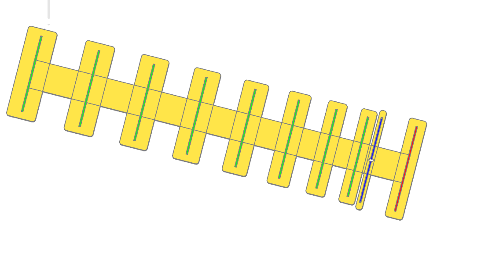

# This a yagi-uda antenna builder, made with CadQuery!

It uses DL6WU basic algorithm to calculate antenna parameters.
It also can build a casing around the antenna to hold elements (for 3d printing).

For visualization it uses ocp_vscode. Run it another terminal (`python -m ocp_vscode --tree_width=240`), then visit localhost:3939

Here's how it looks with casing:

